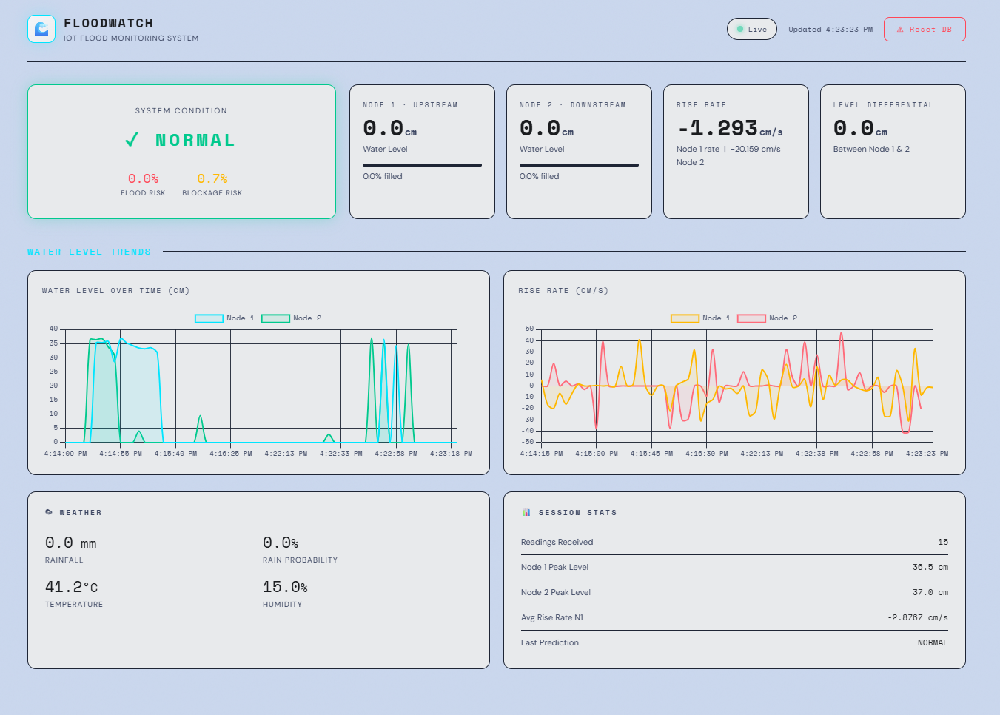
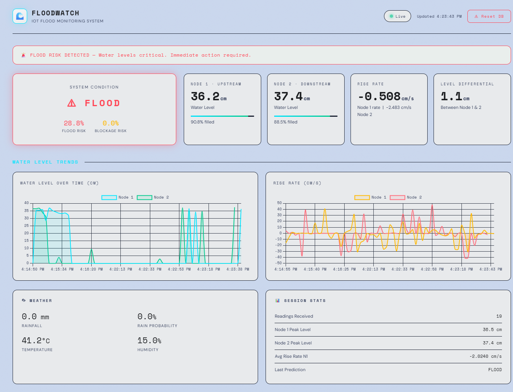
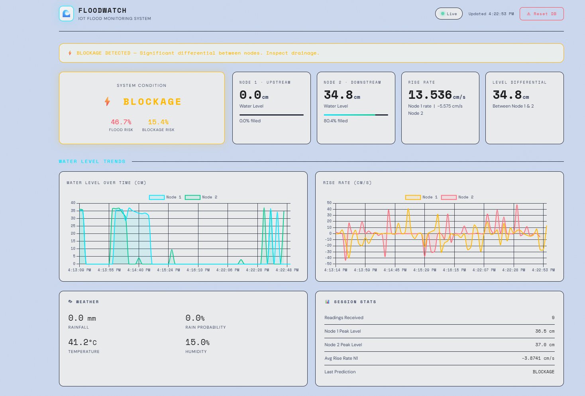
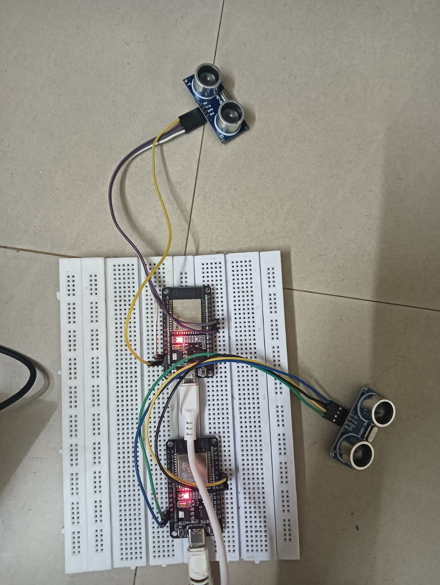

# 🌊 FloodWatch — IoT Flood Monitoring System

Real-time flood and drainage-blockage detection using ESP32 ultrasonic sensors, a Flask backend, MySQL database, and a RandomForest ML model.

---

## Architecture

```
┌──────────────────────────────────────────────────────────────┐
│                     Hardware Layer                           │
│  ┌─────────────┐         ┌─────────────┐                    │
│  │  Node 1     │         │  Node 2     │                    │
│  │  ESP32      │         │  ESP32      │                    │
│  │  HC-SR04    │         │  HC-SR04    │                    │
│  │ (Upstream)  │         │(Downstream) │                    │
│  └──────┬──────┘         └──────┬──────┘                    │
│         │  POST /api/water-level│                           │
└─────────┼─────────────────────  ┼────────────────────────── ┘
          │         WiFi          │
          ▼                       ▼
┌──────────────────────────────────────────────────────────────┐
│                   Flask Server (app.py)                      │
│                                                              │
│  ┌──────────────┐  ┌──────────────┐  ┌──────────────────┐  │
│  │ Sensor Data  │  │  ML Model    │  │  Weather API     │  │
│  │ Ingestion    │  │ (RF + Rules) │  │  (Tomorrow.io)   │  │
│  └──────┬───────┘  └──────┬───────┘  └────────┬─────────┘  │
│         │                 │                    │            │
│         ▼                 ▼                    ▼            │
│  ┌─────────────────────────────────────────────────────┐    │
│  │              MySQL Database                         │    │
│  │   sensor_readings | predictions | weather_data      │    │
│  └──────────────────────────┬──────────────────────────┘    │
└─────────────────────────────┼────────────────────────────── ┘
                              │
                              ▼
                   ┌──────────────────┐
                   │  dashboard.html  │
                   │  (Chart.js UI)   │
                   │  Auto-refresh 5s │
                   └──────────────────┘
```

---

## Features

- **Dual-node sensing** — Two ESP32 + HC-SR04 sensors at upstream and downstream points
- **Rule-based + ML hybrid prediction** — Rules take priority; RandomForest supplements when NORMAL
- **Real-time dashboard** — Auto-refreshing Chart.js UI with live water level, rise rate, and condition badge
- **Weather integration** — Tomorrow.io API (fallback to dummy values when no key)
- **MySQL persistence** — Three tables: `sensor_readings`, `predictions`, `weather_data`
- **Thread-safe** — All DB operations protected by a threading Lock
- **Environment-configured** — All secrets in `.env`

---

## API Endpoints

| Method | Endpoint | Description |
|--------|----------|-------------|
| POST | `/api/water-level` | Receive ESP32 sensor JSON |
| GET | `/api/latest` | Latest readings + prediction + weather |
| GET | `/api/history?hours=N&device_id=N` | Historical sensor data |
| GET | `/api/predict` | On-demand prediction (fetches live weather) |
| GET | `/api/weather` | Fetch + store fresh weather data |
| GET | `/api/device/<id>/stats` | Per-device statistics |
| POST | `/api/reset` | Clear all DB data |
| GET | `/` | Serve dashboard |

---

## ESP32 JSON Payload

```json
{
  "device_id": 1,
  "water_level": 12.50,
  "rise_rate": 0.0312,
  "percentage": 31.25
}
```

---

## ML Model

- **Algorithm**: RandomForestClassifier (300 estimators, max depth 18, balanced class weights)
- **Features** (in this exact order): `water_level_node1`, `water_level_node2`, `level_diff`, `rise_rate_node1`, `rise_rate_node2`, `precipitationIntensity`, `precipitationProbability`, `precipitationIntensity_next_hour`
  - `level_diff` is `water_level_node1 - water_level_node2`, always computed server-side — it is never sent by the ESP32.
  - The three `precipitation*` features come from the Tomorrow.io weather integration already in the project.
- **Labels**: `blockage` (0) · `flood` (1) · `normal` (2) *(LabelEncoder alphabetical order)*
- **Prediction**: `model.predict()` selects the class; `model.predict_proba()` supplies `flood_probability`, `blockage_probability`, and `normal_probability` (percentages, 0–100) directly — nothing is estimated manually.
- **Fallback**: if the model/encoder fail to load, a simple rule-based fallback (large differential, high rise rate, extreme levels) keeps the API responding instead of crashing.

---

## Model Training

- The training workflow lives in the `model_training/` folder:
  - `generate_dataset.py` — synthesizes the 8-feature dataset (`normal` / `flood` / `blockage` samples).
  - `train_model.py` — trains the RandomForest on `dataset.csv` and writes `model.joblib` + `encoder.joblib` to `manhole_model_output/`, then automatically deploys copies into `server/models/`.
  - `phase2_model_training.ipynb` — the exploratory notebook version of the same pipeline (kept alongside `phase1_model_training.ipynb` for history).
- To retrain: `cd model_training && python generate_dataset.py && python train_model.py` (or drop in your own `dataset.csv` with the same 8 columns + `label`, then just run `train_model.py`).
- The Flask app loads `server/models/model.joblib` and `server/models/encoder.joblib` at startup (falling back to `server/model.joblib` / `server/encoder.joblib` if present).

---

## Folder Structure

```
project/
├── HC-SR04/
│   ├── platformio.ini
│   └── src/
│       └── main.cpp
│   └── lib/
│       └── WaterLevel/
│           ├── WaterLevel.h
│           └── WaterLevel.cpp
├── server/
│   ├── app.py
│   ├── dashboard.html
│   ├── requirements.txt
│   ├── models/
│   │   ├── model.joblib     # runtime model (copy from model_training/manhole_model_output)
│   │   └── encoder.joblib   # runtime encoder (copy from model_training/manhole_model_output)
│   ├── model.joblib         # fallback copy
│   ├── encoder.joblib       # fallback copy
│   ├── .env
│   └── SETUP.md
└── model_training/
  ├── phase1_model_training.ipynb
  ├── phase2_model_training.ipynb
  ├── generate_dataset.py
  ├── train_model.py
  ├── dataset.csv
  └── manhole_model_output/
    ├── dataset.csv
    ├── encoder.joblib
    └── model.joblib
```

---

## Screenshots

> Dashboard — Normal State
> 

> Dashboard — Flood Alert
> 

> Dashboard — Blockage Alert
> 

> Esp32 node 1 and node2 -HC-SR04
> # Smart-Urban-Drainage-Monitoring-System-With-ML-Based-Flood-and-Blockage-Detection-

